# 設備点検システム 取扱説明書

社内LANの1台のPCをサーバーにして、設備の点検記録・点検表の印刷・サイネージ表示・文書の閲覧をまとめて行うアプリです。
この説明書は、**アプリを自分の職場に導入する担当の方**に向けて書いています。入れ方からサンプルでの試し方、自分の職場への置き換え、毎日の点検、月末の印刷までを順に説明します。

> **ご利用の前に（免責事項）**
> このアプリは「現状有姿」で提供し、作者はいかなる保証もしません。使ったことで生じた損害について、作者は責任を負いません。高圧ガス保安法・消防法・労働安全衛生法などの法令に基づく点検記録や保安上の判断に、このアプリだけを用いないでください。くわしくは、アプリのフォルダの `README.md` の「免責事項」を見てください。

> **この説明書の画面写真について**
> 写真に写っている「サンプル工業 第一工場」や人名・電話番号は、すべて架空のものです。アプリに付いているサンプル（`samples` フォルダ）を読み込ませて撮影しています。

## 目次

1. [このアプリでできること](#1-このアプリでできること)
2. [用意するもの](#2-用意するもの)
3. [入れ方と起動](#3-入れ方と起動)
4. [サンプルで試す](#4-サンプルで試す)
5. [毎日の点検](#5-毎日の点検)
6. [月末のPDF出力](#6-月末のpdf出力)
7. [サイネージ](#7-サイネージ)
8. [文書閲覧とWeb表示](#8-文書閲覧とweb表示)
9. [自分の職場に合わせる](#9-自分の職場に合わせる)
10. [自分の点検用紙を使う](#10-自分の点検用紙を使う)
11. [他のPCやタブレットから使う](#11-他のpcやタブレットから使う)
12. [バックアップと引っ越し](#12-バックアップと引っ越し)
13. [困ったとき](#13-困ったとき)
14. [付録：サンプルを作り直すには](#付録サンプルを作り直すには)
15. [付録：用語集](#付録用語集)

---

## 1. このアプリでできること

アプリには4つの画面があります。どれもブラウザ（Edge または Chrome）で開きます。

| 画面 | アドレス | できること |
|---|---|---|
| サイネージ | `http://localhost:5000/` | お知らせのPDF・画像・動画を順番に映す。下にニュースの文字が流れる |
| 点検 | `http://localhost:5000/inspection` | 使用前点検・月例点検を記録する。月末に点検結果をPDFで出す |
| 文書閲覧 | `http://localhost:5000/documents` | 手順書などのPDFを、分類ごとのボタンから開く |
| 様式レイアウト | `http://localhost:5000/layout` | 会社の紙の点検表（PDF）の「どこに何を印字するか」を決める |

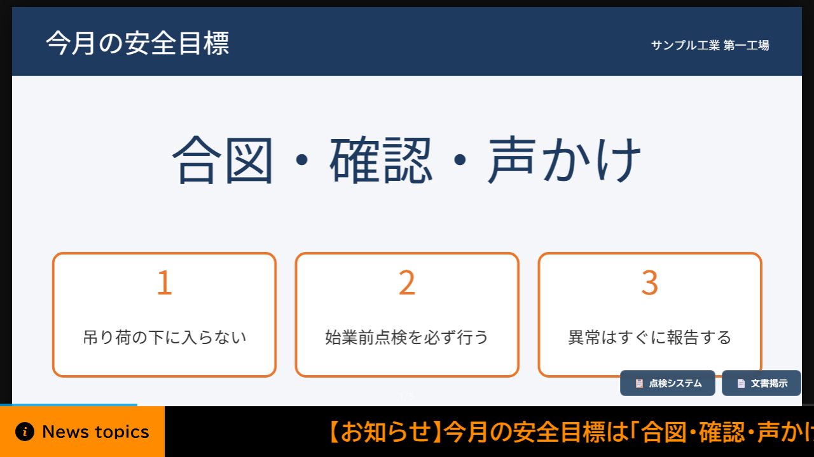

*サイネージ画面。右下のボタンから点検画面・文書閲覧へ移れます。*

#### 特徴

- サーバーにするPCは1台だけです。ほかのPCやタブレットには何も入れず、ブラウザで開くだけで使えます。
- データはすべてサーバーのPCの中のファイルに保存します。インターネット上には送りません。
- 点検の結果は、会社でいま使っている紙の点検表と同じ形のPDFに印字できます。

---

## 2. 用意するもの

| もの | 内容 |
|---|---|
| サーバーにするPC | Windows 10 または 11。点検する時間帯は電源を入れたままにします |
| Python | 3.10 以降。入れ方は次の章で説明します |
| ブラウザ | Microsoft Edge（Windowsに最初から入っています）または Google Chrome |
| インターネット | 最初のセットアップのときだけ必要です。動かし始めたあとは要りません |

---

## 3. 入れ方と起動

### 3-1. Python を入れる（初めてのときだけ）

1. Python の公式サイト（https://www.python.org/ ）から、Windows 用のインストーラーをダウンロードします。
2. インストーラーを開き、最初の画面の下にある **「Add python.exe to PATH」に必ずチェックを入れて** から「Install Now」を押します。

> **注意**
> 「Add python.exe to PATH」のチェックを忘れると、次の「初回セットアップ.bat」が「Python が見つかりません」と表示して止まります。そのときは Python をもう一度インストールし直して、チェックを入れてください。

### 3-2. アプリを取ってくる

1. GitHub のこのアプリのページで、緑色の「Code」ボタン →「Download ZIP」を押します。
2. ダウンロードした ZIP を右クリック →「プロパティ」を開きます。下のほうに「セキュリティ：このファイルは他のコンピューターから取得したものです…」と出ていたら、**「許可する」にチェックを入れて「OK」** を押します。
3. ZIP を右クリック →「すべて展開」で、分かりやすい場所に展開します。この説明書では `C:\equipment-inspection` に置いた前提で書きます。

> **2 の「許可する」について**
> インターネットから取ったファイルには、Windows が「外から来たファイル」という印を付けます。そのまま展開すると、中の `.bat` を開いたときに「Windows によって PC が保護されました」などの警告が出て、止められることがあります（出方は、PCの設定によって違います）。展開する前に「許可する」にしておけば、この警告は出ません。展開したあとで警告が出たときは、「詳細情報」→「実行」で進めます。

> **ヒント**
> フォルダの場所や名前に日本語が入っていても動きます。ただし、OneDrive と同期しているフォルダ（デスクトップなど）は、同期の都合でファイルが一時的に開けなくなることがあるため、避けたほうが安心です。

### 3-3. 初回セットアップ（初めてのときだけ）

1. アプリのフォルダにある **`初回セットアップ.bat`** をダブルクリックします。
2. 黒い窓が開き、必要な部品を自動でダウンロードします（数分かかります）。
3. 「セットアップが完了しました」と出たら、何かキーを押して窓を閉じます。

> **「ライブラリのインストールに失敗しました」と出たとき**
> 初回セットアップは、インターネットから部品をダウンロードします。会社のネットワークが外部への接続を制限している（プロキシなど）と、ここで失敗します。インターネットにつながるか確かめ、つながっているのに失敗するときは、社内の情報システムの担当者に「Python の pip で、pypi.org からダウンロードできるようにしてほしい」と相談してください。

### 3-4. 起動する（毎回）

1. **`起動.bat`** をダブルクリックします。
2. 黒い窓が開き、3秒ほどで Edge がサイネージ画面を開きます。

> **大切**
> 黒い窓が、アプリの本体です。**使っているあいだは閉じないでください。** 閉じるとアプリが止まり、どの画面も開けなくなります。最小化しておくのはかまいません。

**終わるとき**は、黒い窓をクリックしてから `Ctrl` キーを押しながら `C` キーを押します。

### 3-5. PCの電源を入れたら自動で起動させる

サイネージ用のPCなど、毎朝だれかが `起動.bat` を押すのが難しいときは、Windows の起動と同時にアプリが動くようにします。

1. `起動.bat` を右クリック →「その他のオプションを確認」→「ショートカットの作成」を押します。
2. キーボードの `Windows` キーを押しながら `R` キーを押し、出てきた欄に `shell:startup` と入力して Enter を押します。「スタートアップ」フォルダが開きます。
3. 1 で作ったショートカットを、このフォルダへ移します。

次に Windows にサインインしたときから、アプリとサイネージ画面が自動で開きます。

> **PCがスリープしないようにする**
> PCがスリープすると、アプリも止まり、ほかのPCから開けなくなります。サーバーにするPCは、「設定」→「システム」→「電源」（ノートPCでは「電源とバッテリー」）→「画面とスリープ」で、スリープを「なし」にしてください。画面だけ消えるのはかまいません。

---

## 4. サンプルで試す

アプリには、架空の工場「サンプル工業 第一工場」のサンプルが付いています。自分の職場のデータを入れる前に、サンプルで一通り試すと、全体の流れがつかめます。

### 4-1. サンプルの中身

`samples` フォルダに、次のものが入っています。

| フォルダ | 中身 |
|---|---|
| `samples\forms` | 点検用紙3種類（月に1枚・年に1枚・1回の点検で1枚）と、印字位置の設定 |
| `samples\signage` | サイネージ用のPDF3本、画像、動く画像（GIF）、ニュースの文字（`news.txt`） |
| `samples\documents` | 文書閲覧用の手順書などのPDF（3つの分類） |
| `samples\results` | 2026年10月度（9月24日〜10月23日）の点検記録 |

機器・点検項目・点検者の一覧（`data` フォルダ）は、最初からサンプルの工場の内容になっています。

### 4-2. サンプルをコピーする

アプリをいったん終わらせてから（黒い窓で `Ctrl` + `C`）、アプリのフォルダの中で次のようにコピーします。フォルダが無いときは、新しく作ってください。

| コピー元 | コピー先 | コピーするもの |
|---|---|---|
| `samples\forms` の中身 | `forms` | `form_01`・`form_02`・`form_03` の3つのフォルダ |
| `samples\signage` の中身 | `signage_pdfs` | フォルダの中のファイルすべて |
| `samples\results` の中身 | `results` | `2026-01` 〜 `2026-10` のフォルダすべて |

コピーしたら、`起動.bat` でもう一度起動します。

### 4-3. 建物名と管理者を入れる

1. サイネージ画面の右下の「点検システム」を押して、点検画面を開きます。
2. 右上の「⚙ 設定」を押します。
3. 「建物情報」に建物名（例：サンプル工業 第一工場）、「管理者」に役職・氏名・電話番号を入れて「保存」を押します。

建物名は、点検画面の左側と、出力するPDFの見出しに出ます。

### 4-4. 文書閲覧の分類を登録する

1. サイネージ画面の右上の「⚙」を押して、サイネージ設定を開きます。
2. 下のほうの「文書掲示」で、「ボタン数」を `3` にします。
3. 3つの行に、ボタンの名前とフォルダの場所を入れます。

   | ボタンの名前 | フォルダの場所（`C:\equipment-inspection` に置いた場合） |
   |---|---|
   | 作業手順書 | `C:\equipment-inspection\samples\documents\作業手順書` |
   | 機器の取扱い | `C:\equipment-inspection\samples\documents\機器の取扱い` |
   | 緊急連絡体制 | `C:\equipment-inspection\samples\documents\緊急連絡体制` |

4. 「保存して適用」を押します。

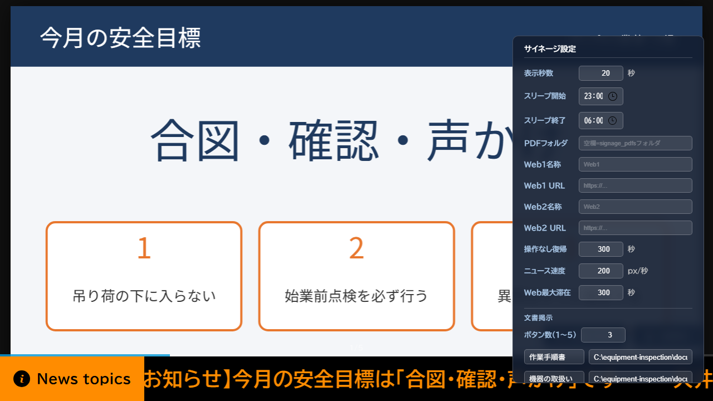

*サイネージ設定。文書閲覧のボタンもここで決めます。*

> **ヒント**
> フォルダの場所は、エクスプローラーでそのフォルダを開き、上のアドレス欄をクリックするとコピーできます。

### 4-5. 10月度の点検表とPDFを見る

サンプルの記録は **2026年10月度** の分です。

1. 点検画面の「年月」を **2026年10月** にします。
2. 下のほうに、選んでいる機器の1か月分の点検表が出ます。
3. 下の「📄 PDF出力」を押すと、10月度の点検結果PDFが開きます。

PDFの中身は、[6. 月末のPDF出力](#6-月末のpdf出力) で説明しています。

点検画面の右上の「🗂 様式レイアウト」を押すと、サンプルの3つの用紙に、どの項目をどこへ置いているかを見られます。自分の用紙で設定するときの手本になります（[10章](#10-自分の点検用紙を使う) 参照）。

> **サンプルを片付けるとき**
> 自分の職場で使い始める前に、`forms`・`signage_pdfs`・`results` にコピーしたサンプルを、別のフォルダへ移してください。`data` フォルダの表の直し方は [9. 自分の職場に合わせる](#9-自分の職場に合わせる) で説明します。使い始める前に確かめることは、[9-3 のチェックリスト](#9-3-使い始める前のチェックリスト) にまとめてあります。

---

## 5. 毎日の点検

点検には2つの種類があります。

| 種類 | いつ | 日付 |
|---|---|---|
| 使用前点検 | 毎日、その機器を使う前 | **その日の分だけ** 記録できます（日付は変えられません） |
| 月例点検 | 月に1回 | 点検した日を選んで記録します |

### 5-1. 使用前点検

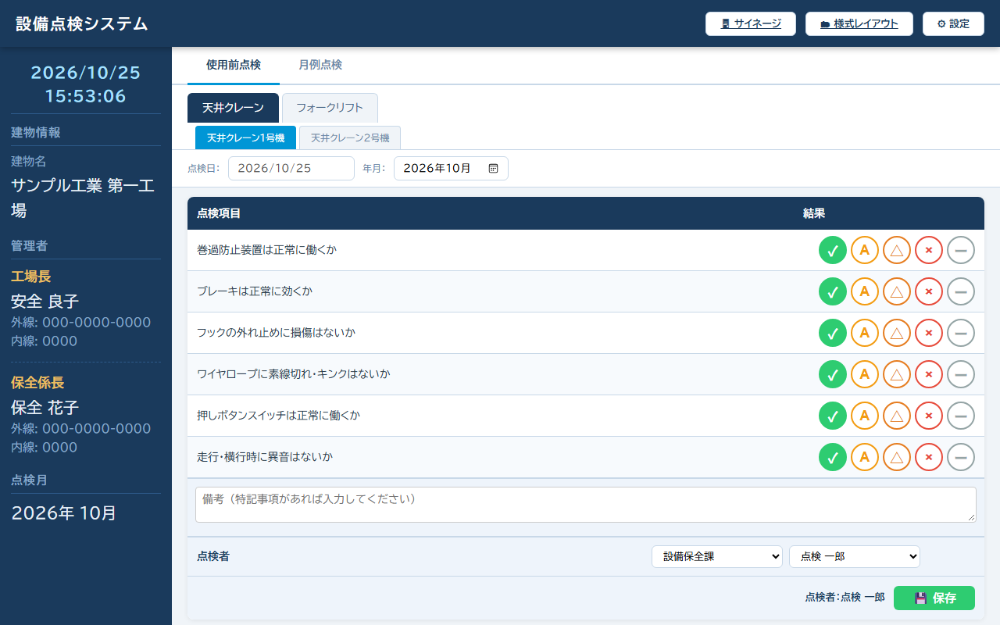

1. 上のタブで「使用前点検」を選びます。
2. 機器の種類（例：天井クレーン）のタブを押し、その下の機器（例：天井クレーン1号機）を押します。
3. 点検項目ごとに、右の5つの印から1つを押します。

   | 印 | 意味 |
   |---|---|
   | ✓ | 良 |
   | A | 要調整 |
   | △ | 修理 |
   | × | 要取替 |
   | ー | 対象外（その日はその項目を点検しない） |

4. 気づいたことがあれば「備考」に書きます。ここに書いた内容は、PDFの1枚目「特記事項」に載ります。
5. 「点検者」で部署と氏名を選びます。
6. 「💾 保存」を押します。

> **大切：保存すると、画面からは直せません**
> 保存すると「✅ 本日の点検は終了しました」と出て、その機器のその日の入力欄は押せなくなります。**「💾 保存」を押す前に、印・備考・点検者を見直してください。**
> 間違えて保存してしまったときは、管理者に伝えてください。PDFの1枚目（特記事項）に残るよう、翌日の点検の「備考」に訂正の内容を書いておく方法もあります。

> **注意**
> A・△・× のどれかを付けて保存すると、「不合格の項目があります」という警告が出ます。すぐに管理者へ連絡し、異常の内容を「備考」に書いてください。

> **キーボードの近道**（キーボードのあるPCで使えます）
> - `*` キー：表示している機器の項目を全部「✓」にします。
> - `1`〜`9` キー：点検者の一覧の上から1〜9番目の人を選びます。

#### 点検表（1か月分）

画面の下には、選んでいる機器の1か月分の結果が表で出ます。土曜は青、日曜・祝日は赤、会社の休日は黄色です。

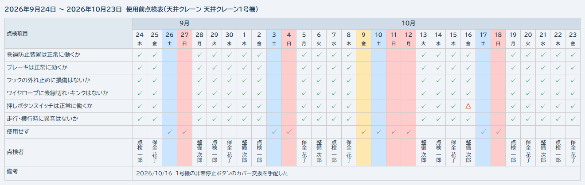

#### 「使用せず」の印について

使用前点検の記録が無いまま次の日になると、その日は「使用せず」に自動で ✓ が付きます。機器を使わなかった日（休日など）に、わざわざ入力する必要はありません。今日と未来の日には付きません。

> **点検を忘れた日は、あとから入れられません**
> 使用前点検は、その日の分しか入力できません。入れ忘れた日は「使用せず」の扱いになります。実際には点検していた場合は、管理者に伝え、次の点検の「備考」にその旨を書いてください。

### 5-2. 月例点検

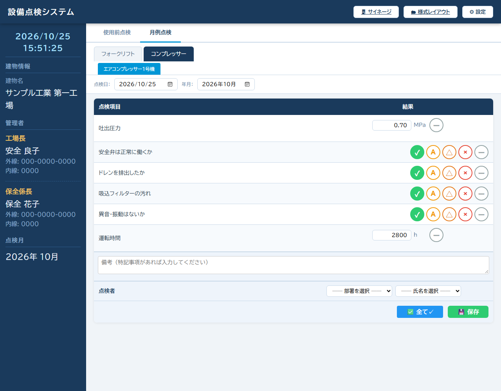

1. 上のタブで「月例点検」を選びます。
2. 機器の種類と機器を選びます。
3. 「点検日」で点検した日を、「年月」でどの月度の点検かを選びます。
4. 印を押す項目は使用前点検と同じです。数字を書く項目（例：吐出圧力）は、測った値を入れます。単位は横に出ています。数字の欄を押すと、画面にテンキーが出ます。タブレットでは、このテンキーで入力して「確定」を押します（キーボードで入れてもかまいません）。測っていないときは、横の「ー」を押します。
5. 「✅ 全て✓」を押すと、印の項目がまとめて ✓ になります（数字の項目は変わりません）。
6. 点検者を選んで「💾 保存」を押します。

> **大切**
> 月例点検も、その月度の分を保存すると「終了」の表示になり、画面からは直せません。保存する前に見直してください。

### 5-3. 点検の「月度」について

このアプリの1か月は、暦の1日〜月末ではなく、**締め日で区切ります**。最初の設定では **24日始まり** で、たとえば「10月度」は 9月24日〜10月23日です。締め日は「⚙ 設定」の「点検サイクルの締め日」で変えられます。

---

## 6. 月末のPDF出力

点検画面の下の「📄 PDF出力」を押すと、「年月」で選んでいる月度の点検結果PDFが開きます。あわせて、特記事項の一覧（CSV）もダウンロードされます。

> **PDFが出ないとき**
> 次のどちらかに当てはまると、メッセージが出てPDFは出ません。
> - その月度に、一度も使用前点検をしていない機器がある
> - その月の月例点検が終わっていない機器がある
>
> メッセージに機器の名前が出るので、その機器の点検を記録してから、もう一度押してください。

### PDFの並び

| 順番 | 中身 |
|---|---|
| 1枚目 | **特記事項**：その月度に「備考」に書かれた内容の一覧 |
| 2枚目から | **点検用紙**：会社の紙の点検表の形に印字したもの（[10章](#10-自分の点検用紙を使う) で作ります） |
| 最後 | **表**：すべての機器の結果を、アプリの決まった形の表にしたもの |

#### 1枚目：特記事項

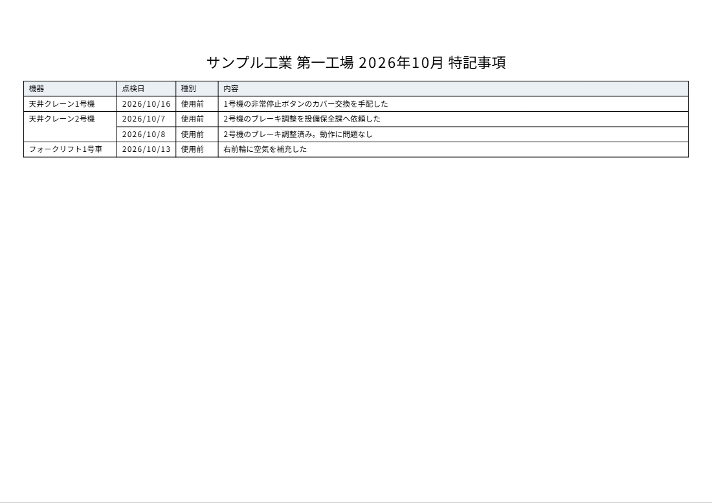

#### 2枚目から：点検用紙（サンプルの3種類）

月に1枚の用紙（天井クレーン2台分）です。2台の結果は1つのマスにまとめ、悪いほうの印が入ります（悪い順は × ＞ △ ＞ A ＞ ✓ ＞ ー）。「対象機器」の欄には、その日に点検した機器に ✓ が入ります。土曜は青、日曜・祝日・会社の休日は赤の丸で囲まれます。

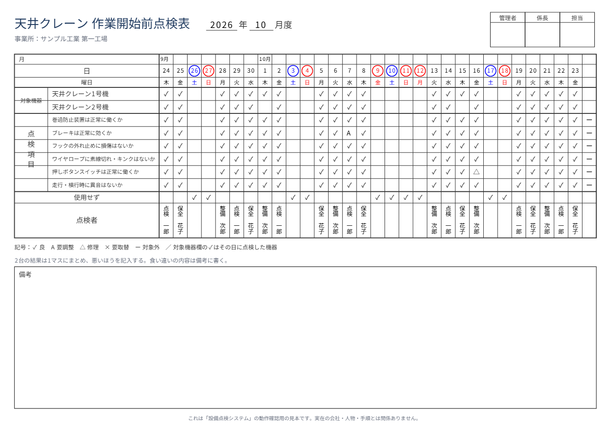

年に1枚の用紙（エアコンプレッサー）です。1月〜12月の欄に、その月の月例点検の結果が入ります。

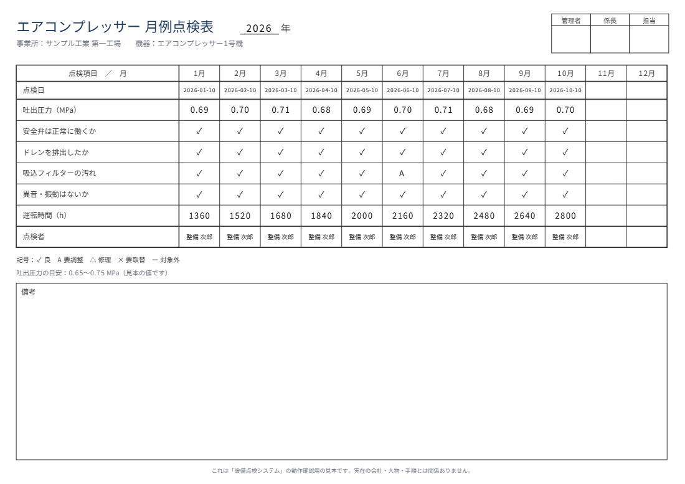

1回の点検で1枚の用紙（フォークリフト）です。その月度に点検した日の数だけ、ページができます。

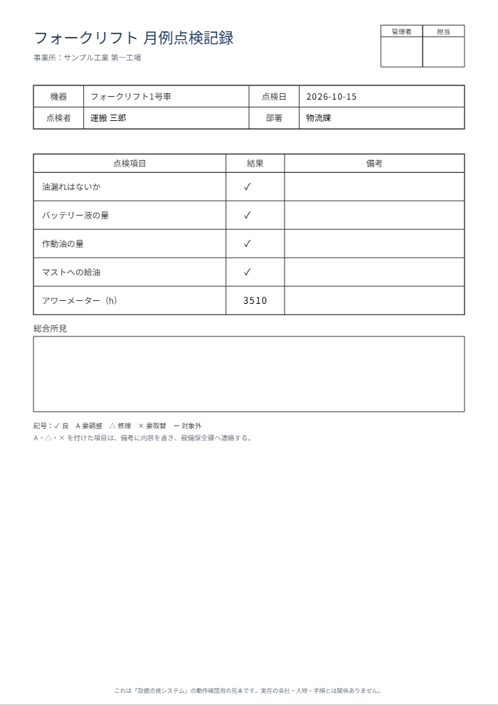

#### 最後：表

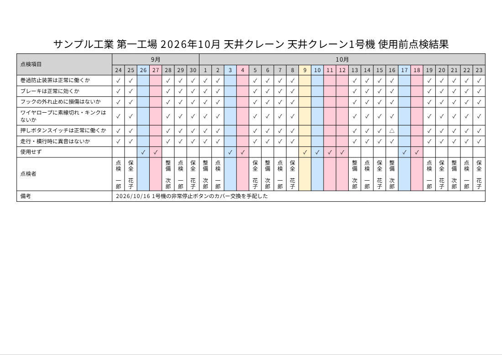

> **特記事項のCSVについて**
> 一緒にダウンロードされる特記事項のCSVは、締め日ではなく **暦の1日〜月末** で集めています。そのため、PDFの1枚目と件数が合わないことがあります。

---

## 7. サイネージ

サイネージ画面は、フォルダに入れたファイルを順番に映します。

### 7-1. 映すファイルを入れる

アプリのフォルダの `signage_pdfs` に、映したいファイルを入れます。入れたファイルは、次に切り替わるときから自動で映ります（アプリの再起動は要りません）。

| 種類 | 拡張子 | 映り方 |
|---|---|---|
| PDF | `.pdf` | 1ページずつ、決めた秒数ごとにめくります |
| 画像 | `.png` `.jpg` `.jpeg` `.gif` | 決めた秒数だけ映します |
| 動画 | `.mp4` `.webm` | 最後まで再生してから次へ進みます |
| ニュースの文字 | `.txt` | 画面の下に流れます。1行が1つのニュースです |

- **映る順番はファイル名の順** です。順番を決めたいときは、`01_…`、`02_…` のように先頭に番号を付けます。
- 映っている最中のファイルも、差し替えたり消したりできます。

### 7-2. サイネージの設定

右上の「⚙」で設定を開きます（写真は [4-4](#4-4-文書閲覧の分類を登録する) にあります）。

| 項目 | 内容 |
|---|---|
| 表示秒数 | PDFの1ページ・画像1枚を映す秒数 |
| スリープ開始・終了 | この時間帯は、画面が時計だけの表示になります |
| PDFフォルダ | 映すファイルのフォルダ。空欄なら `signage_pdfs` |
| Web1・Web2 | Web表示のボタンの名前とアドレス（[8-2](#8-2-web表示) 参照） |
| 操作なし復帰 | ほかの画面で、操作しないままこの秒数がたつと、サイネージに戻ります |
| ニュース速度 | 下に流れる文字の速さ |
| 文書掲示 | 文書閲覧のボタンの数・名前・フォルダ |

- 右下の「📋 点検システム」「📄 文書掲示」で、それぞれの画面へ移れます。
- スリープ中は、画面に触れると映る状態に戻ります。3分間なにも操作しないと、またスリープになります。
- 左右の矢印・画面のスワイプ・キーボードの矢印キーで、手動でめくることもできます。
- **全画面にする**：サイネージ画面で `F11` キーを押すと、ブラウザの枠が消えて全画面になります。もう一度 `F11` で元に戻ります。
- **動画の音**：画面に「🔊 音を出す」ボタンが出ているときは、ブラウザが音の自動再生を止めています。押すと音が出るようになります。`起動.bat` で開いた画面では、ふつうは最初から音が出ます。

---

## 8. 文書閲覧とWeb表示

### 8-1. 文書閲覧

手順書や連絡体制表などのPDFを、分類ごとのボタンから開けます。

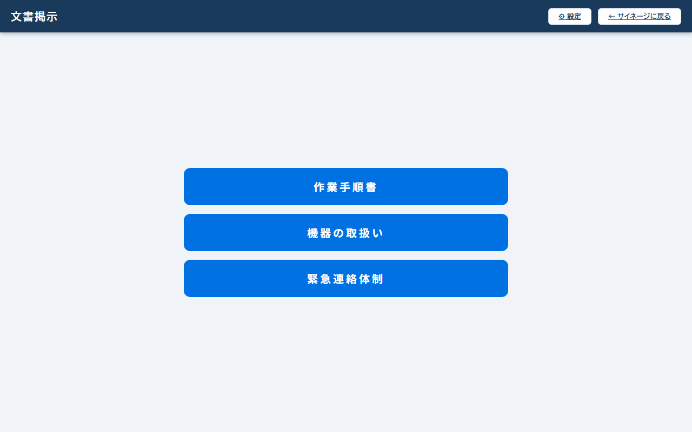

ボタンを押すと、そのフォルダにあるPDFの一覧が出ます。一覧の名前は、ファイル名から `.pdf` を除いたものです。

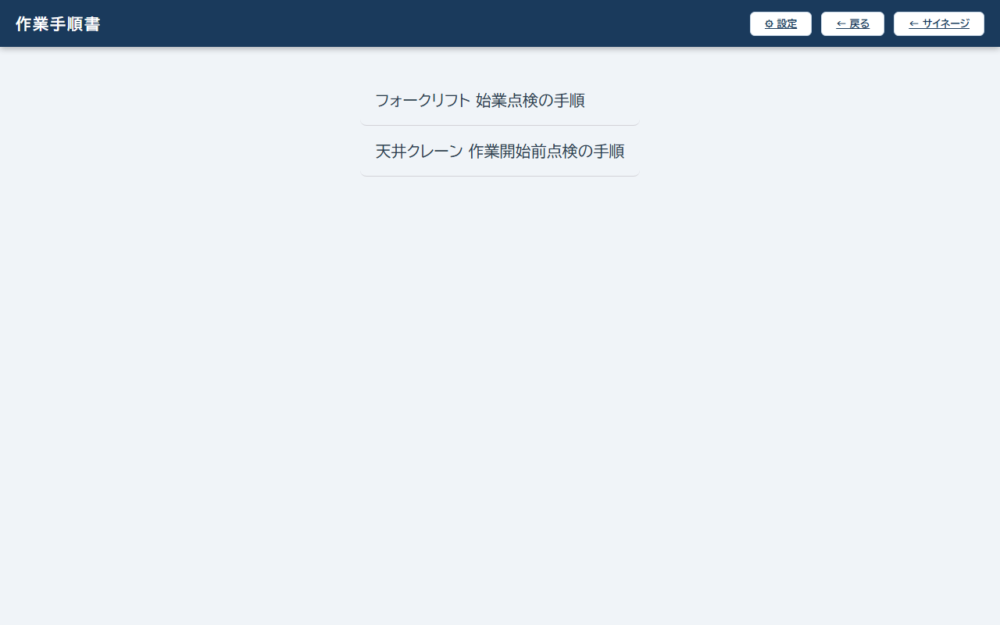

一覧の名前を押すと、PDFが開きます。左右の矢印でページをめくり、指の広げ・マウスのホイールで拡大できます。

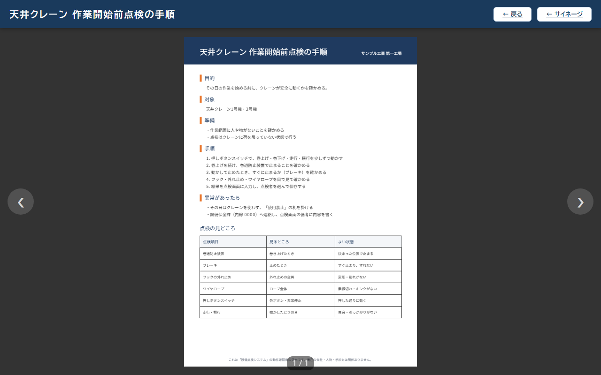

- ボタンの数（1〜5）・名前・フォルダは、サイネージの「⚙」→「文書掲示」で決めます（[4-4](#4-4-文書閲覧の分類を登録する) 参照）。
- フォルダは、社内の共有フォルダ（`\\サーバー名\共有名\…`）でもかまいません。

### 8-2. Web表示

社内のホームページなどを、サイネージのボタンから表示できます（最大2つ）。サイネージの「⚙」で「Web1名称」「Web1 URL」などを入れると、サイネージの右下にボタンが出ます。

> **注意**
> 相手のホームページが「ほかのページの中に表示されること」を禁止している場合は、真っ白になって表示できません。これは相手側の設定によるもので、このアプリでは変えられません。

---

## 9. 自分の職場に合わせる

### 9-1. 点検画面の設定（⚙ 設定）

点検画面の右上の「⚙ 設定」で、次のことを決めます。

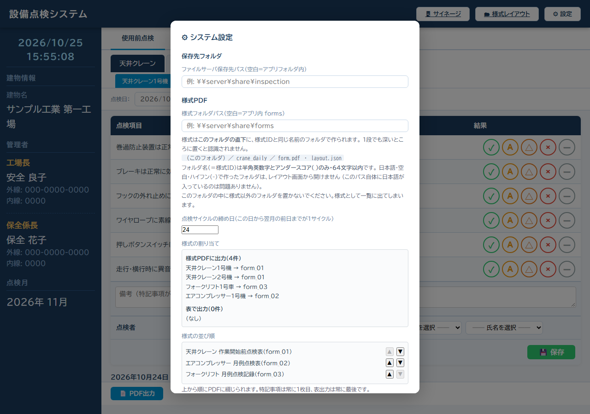

| 項目 | 内容 |
|---|---|
| 保存先フォルダ | 点検記録の保存先。空欄ならアプリの中の `results` |
| 様式フォルダ | 点検用紙の置き場所。空欄ならアプリの中の `forms` |
| 点検サイクルの締め日 | 月度の区切りの日（最初は24日） |
| 様式の割り当て | どの機器が、どの点検用紙に印字されるかの一覧（見るだけ） |
| 様式の並び順 | PDFに綴じる点検用紙の順番。▲▼ で入れ替えます |
| 建物情報・管理者 | 画面の左とPDFに出る建物名、管理者3名までの連絡先 |

### 9-2. 機器・点検項目・点検者を直す（data フォルダ）

`data` フォルダの3つの表を、Excel またはメモ帳で直します。アプリの再起動は要りません。

> **直したあとは、画面を読み込み直してください**
> 開いたままの画面には、直した内容が出ません。ブラウザで `F5` キーを押して読み込み直すと、新しい機器や点検者が出ます。

#### equipment_master.csv（機器と点検項目）

1行が1つの点検項目です。

| 列 | 内容 | 例 |
|---|---|---|
| `category_major` | 機器の種類（タブの上の段） | 天井クレーン |
| `category_minor` | 機器の名前（タブの下の段） | 天井クレーン1号機 |
| `inspection_item` | 点検項目 | ブレーキは正常に効くか |
| `inspection_type` | 点検の種類 | `使用前`・`月例`・`両方` のどれか |
| `input_type` | 入力のしかた | 空欄なら印を選ぶ。`数値` なら数字を入れる |
| `unit` | 数字の単位（`数値` のときだけ） | MPa |

> **注意**
> 同じ点検項目の名前が、別の機器にあってもかまいません（サンプルでも、2台のクレーンが同じ項目を持っています）。機器の名前（`category_minor`）は、機器ごとに別の名前にしてください。

#### inspectors.csv（点検者）

| 列 | 内容 |
|---|---|
| `inspector_name` | 氏名 |
| `department` | 部署 |

#### custom_holidays.csv（会社の休日）

祝日は自動で分かるので、会社独自の休日だけを書きます。

| 列 | 内容 | 例 |
|---|---|---|
| `date` | 日付（年-月-日） | 2026-10-09 |
| `name` | 休日の名前 | 創立記念日 |

> **Excel で保存するときの注意**
> 「名前を付けて保存」で、ファイルの種類を **「CSV UTF-8（コンマ区切り）」** にしてください。ふつうの「CSV（コンマ区切り）」で保存すると、アプリで日本語が文字化けします。

### 9-3. 使い始める前のチェックリスト

本番で使い始める前に、上から順に確かめてください。

| | 確かめること | 参照 |
|---|---|---|
| □ | サンプル（`forms`・`signage_pdfs`・`results` にコピーしたもの）を片付けた | [4-5](#4-5-10月度の点検表とpdfを見る) |
| □ | `equipment_master.csv` に、自分の職場の機器と点検項目を入れた | [9-2](#9-2-機器点検項目点検者を直すdata-フォルダ) |
| □ | `inspectors.csv` に、点検する人の氏名と部署を入れた | [9-2](#9-2-機器点検項目点検者を直すdata-フォルダ) |
| □ | `custom_holidays.csv` に、会社独自の休日を入れた（祝日は不要） | [9-2](#9-2-機器点検項目点検者を直すdata-フォルダ) |
| □ | 「⚙ 設定」で、建物名・管理者・締め日を入れた | [9-1](#9-1-点検画面の設定-設定) |
| □ | 点検画面で、すべての機器のタブと点検項目が正しく出ることを確かめた | [5章](#5-毎日の点検) |
| □ | 紙の点検表を使う場合、様式を作り、「試し刷り」で位置を確かめた | [10章](#10-自分の点検用紙を使う) |
| □ | サイネージに映すファイルを入れ、文書閲覧のボタンを登録した | [7章](#7-サイネージ)・[8章](#8-文書閲覧とweb表示) |
| □ | ほかのPCやタブレットから開けることを確かめた（使う場合） | [11章](#11-他のpcやタブレットから使う) |
| □ | PCがスリープしない設定にし、必要なら自動起動を設定した | [3-5](#3-5-pcの電源を入れたら自動で起動させる) |
| □ | バックアップの方法（どこへ、いつコピーするか）を決めた | [12章](#12-バックアップと引っ越し) |
| □ | 点検する人に、「保存すると直せない」ことを伝えた | [5-1](#5-1-使用前点検) |

---

## 10. 自分の点検用紙を使う

会社でいま使っている紙の点検表をPDFにしておくと、点検の結果（✓・A・△・×・ー の印、日にち、点検者名など）を、その用紙の決まったマスに印字できます。
どのマスに何を印字するかは、「様式レイアウト」画面で、用紙の上をクリックして決めます。

この章では、サンプルの用紙（天井クレーン2台分の、月に1枚の点検表）を使って、**白紙の用紙に印字の位置を一から設定する手順** を説明します。自分の用紙でも、手順は同じです。

> **注意**
> 様式レイアウト画面は、**アプリを動かしているPCで開いてください。** ほかのPCからは開けません（開こうとすると「管理者認証が必要です」と出ます）。

### 10-1. 準備するもの

- **用紙のPDF**：紙の点検表をスキャナーでPDFにしたもの、または元のファイル（Word・Excel など）からPDFで保存したもの。50MBまでです。
- **機器と点検項目の登録**：用紙に載せる機器と点検項目が、`data` フォルダの `equipment_master.csv` に登録されていること（[9-2](#9-2-機器点検項目点検者を直すdata-フォルダ) 参照）。画面の左の一覧には、ここに登録した点検項目が出ます。

> **ヒント**
> スキャンしたPDFが斜めになっていると、マスの位置が少しずつずれます。なるべくまっすぐにスキャンしてください。元のファイルからPDFにしたものが、いちばん正確です。

### 10-2. 画面の見方

点検画面の右上の「🗂 様式レイアウト」を押すと開きます。

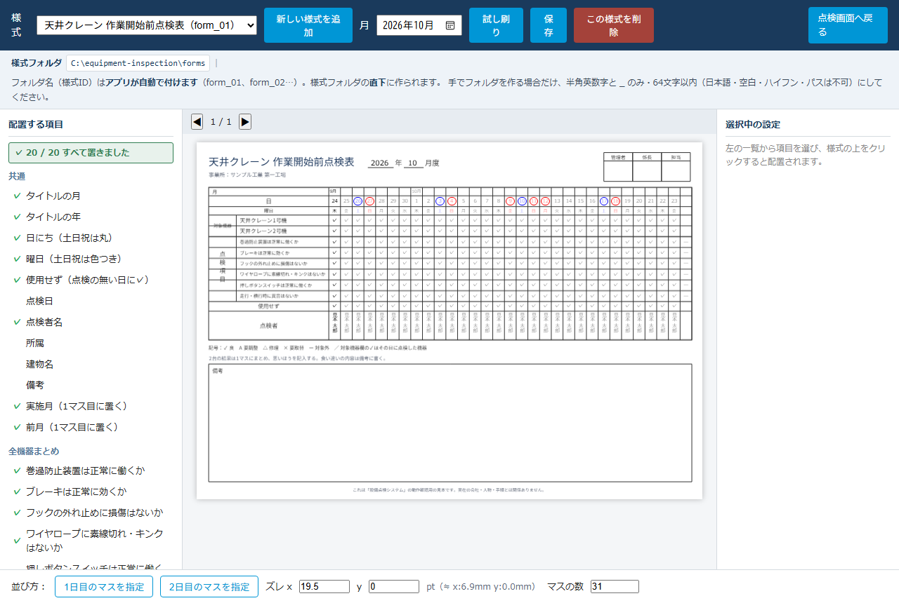

| 場所 | 内容 |
|---|---|
| 上の段 | 様式の切り替え・新しい様式の追加・プレビューの月・試し刷り・保存・削除 |
| 左（配置する項目） | 印字できる項目の一覧。置いた項目には ✓ が付きます。上の枠に、置いた数と残りの数が出ます |
| 中央 | 用紙のPDF。置いた項目が、見本の文字（✓ や「見本 太郎」など）で薄く重ねて表示されます |
| 右（選択中の設定） | 選んでいる配置の、位置・文字の大きさ・縦書きなど |
| 下の段（並び方） | 日ごと（月ごと）に繰り返すマスの間隔と、マスの数 |

上の段の「月」は、画面のプレビューで使う月度です。月度によって日にちの並びや土日祝の丸の位置が変わるので、確かめたい月度を選べます。

### 10-3. 新しい様式を追加する

1. 上の段の「新しい様式を追加」を押します。
2. **手順1**：用紙のPDFを、点線の枠にドラッグします（枠をクリックして選ぶこともできます）。ページ数が表示されたら「次へ」を押します。

   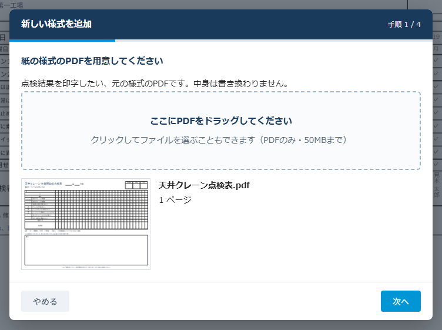

3. **手順2**：用紙の形を選びます。

   | 形 | どんな用紙か | 繰り返し |
   |---|---|---|
   | 1枚に1か月分 | 日付が横（または縦）に並ぶ日常点検表 | 日ごとのマス |
   | 1枚に1年分 | 1月〜12月が並ぶ月例点検表 | 月ごとのマス |
   | 1回の点検で1枚 | 点検のたびに1枚書く記録用紙 | なし（点検日ごとに1ページできる） |

   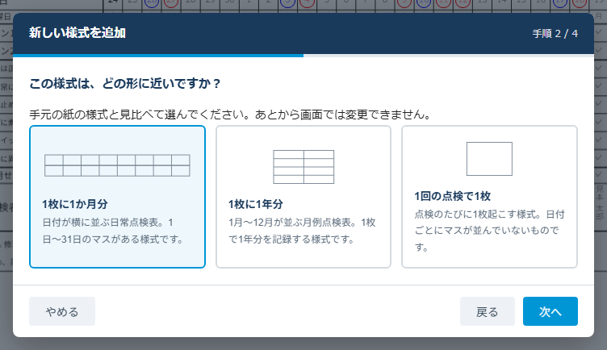

4. **手順3**：この用紙に載っている機器にチェックを入れます。2台以上を選ぶと、2台の結果を1つのマスにまとめる「全機器まとめ」が使えるようになります。

   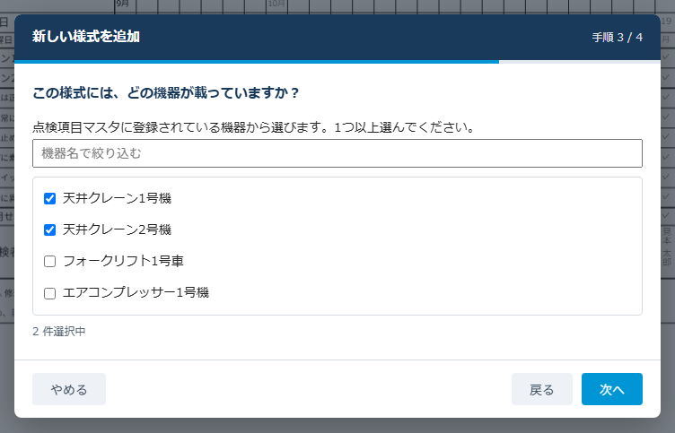

5. **手順4**：様式の名前を付け、どちらの点検（使用前・月例）の結果を印字するかを選んで、「この内容で作成」を押します。

   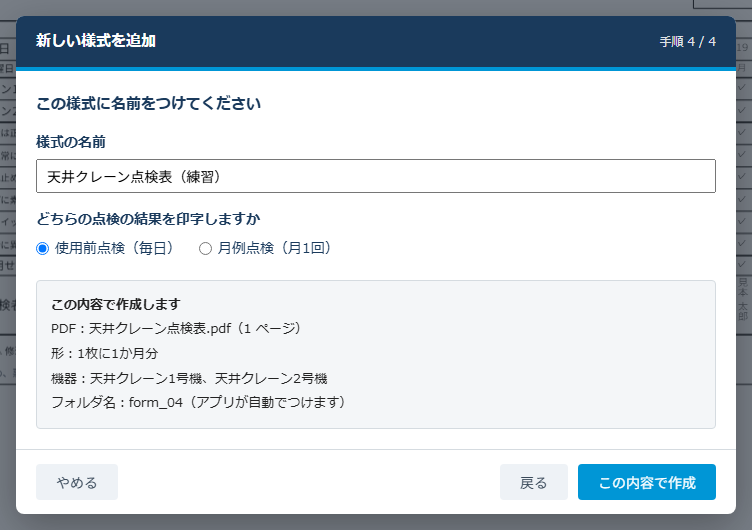

> **注意**
> 用紙の形と機器は、作ったあとで画面からは変えられません。変えたいときは、新しく作り直してください。

作成すると、白紙の用紙が開きます。左上の枠に「置いた 0 / 20」のように、置くべき点検項目の数が出ます。

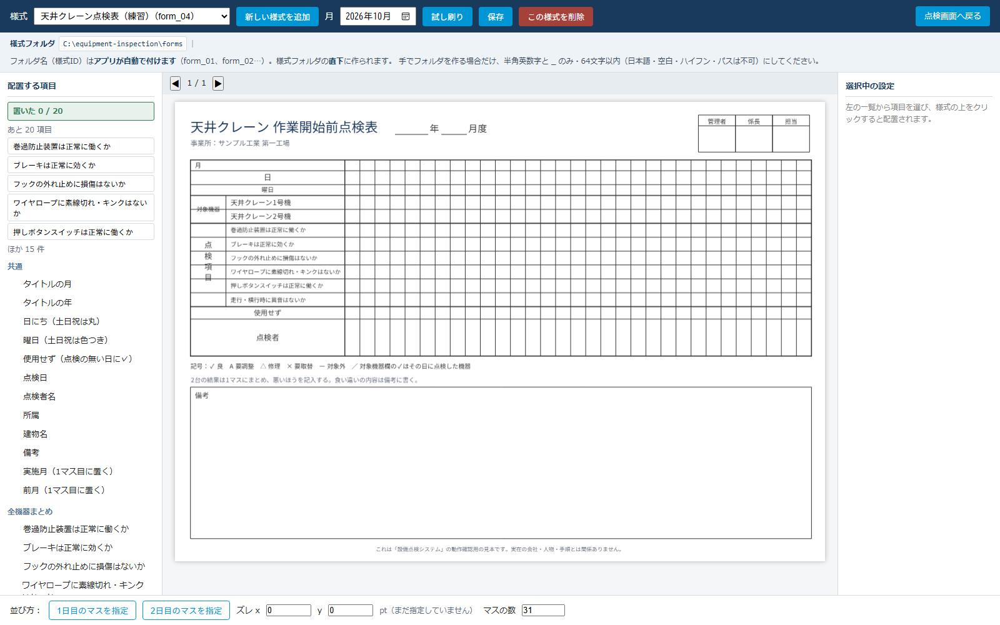

### 10-4. 項目を置く（基本の操作）

1. 左の一覧で、置きたい項目を1回クリックして選びます（青く表示されます）。
2. 中央の用紙の上で、その項目を印字したい位置をクリックします。
3. クリックした位置に印（見本の文字）が出て、右に、その配置の設定が出ます。

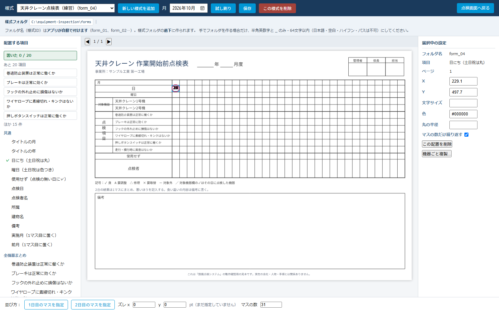

*「日にち」を1日目のマスに置いたところ。右に位置（X・Y）などが出ています。*

**位置の基準**

- ふつうの項目は、**文字の左下** がクリックした位置に来ます。マスの左下の少し内側をクリックすると、マスに収まります。
- 「日にち」と「曜日」だけは、**文字の中央** がクリックした位置に来ます。マスの真ん中をクリックしてください。「日にち」の土日祝の丸も、この位置を中心に描かれます。

**置き直す・動かす・消す**

| したいこと | 操作 |
|---|---|
| 置き直す | 同じ項目を選んだまま、別の場所をクリックする（同じページに同じ項目は1つだけです） |
| 少し動かす | 置いた印をマウスでつかんで動かす。または、印を選んでキーボードの矢印キーを押す（1回で 1pt、`Shift` を押しながらで 10pt） |
| 数字で合わせる | 右の「X」「Y」に数字を入れる |
| 消す | 印を選んで、右の「この配置を削除」を押す |

> **X・Y の数字について**
> 単位は pt（ポイント。1pt ≒ 0.35mm）です。用紙の **左下が 0** で、X は右へ行くほど、Y は **上へ行くほど** 大きくなります。画面の上下と逆なので、「少し下げたい」ときは Y を小さくします。

### 10-5. 1か月分（1年分）のマスを繰り返す

月に1枚の用紙では、日にちごとに同じ並びのマスが続きます。**1日目のマスにだけ** 項目を置き、2日目以降はアプリに繰り返させます。そのために、マスの間隔を一度だけ教えます。

1. 下の段の「1日目のマスを指定」を押します。
2. 用紙の上で、1日目のマスの中のどこかをクリックします（上の段に「つぎに、2日目のマスをクリックしてください」と出ます）。

   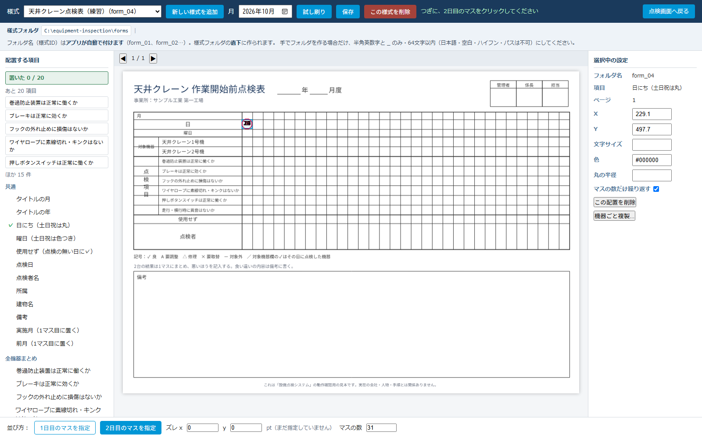

3. 2日目のマスの、**同じ位置** をクリックします。
4. 下の段の「ズレ x」「y」に、マスの間隔が自動で入ります。1日目に置いた項目が、マスの数だけ薄く繰り返して表示されます。
5. 「マスの数」が、用紙の日にちの欄の数（月に1枚なら多くは31）と同じか確かめます。

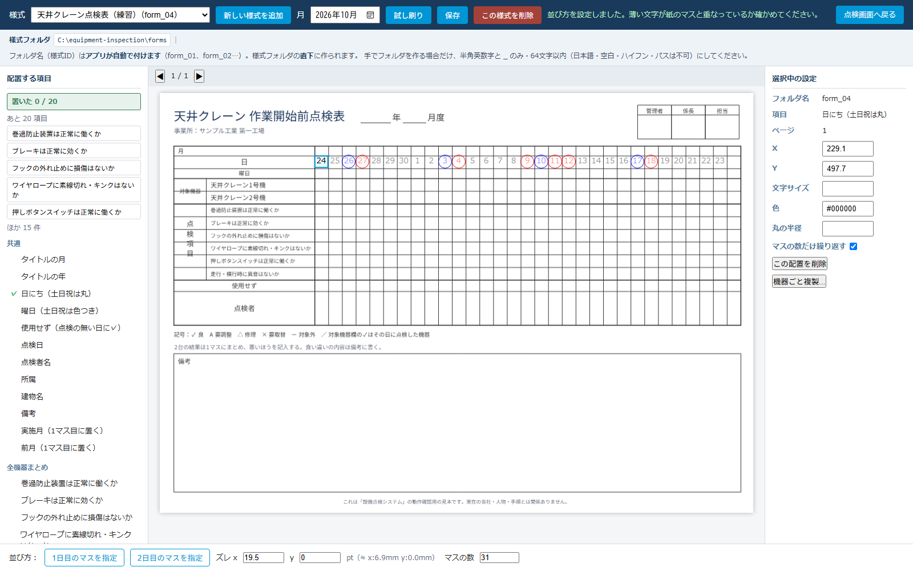

*並び方を指定すると、「日にち」が31マス分に繰り返して表示されます。*

> **ヒント**
> - 間隔を指定するときは、**すでに置いた印の上を避けて** クリックしてください。印の上をクリックすると、印をつかんだことになり、マスの指定になりません。空いている行（例：曜日の行）の同じ位置を押すと確実です。
> - 間隔は、離れたマスで測るほど正確です。ずれが気になるときは、「ズレ x」「y」に数字を直接入れて合わせられます。
> - 1年分の用紙では、ボタンの名前が「1月目のマスを指定」「2月目のマスを指定」になります。1回の点検で1枚の用紙では、この指定は要りません。

**繰り返す項目・繰り返さない項目**

置いた項目ごとに、右の「マスの数だけ繰り返す」で決まります。ふつうは自動で正しく入るので、変える必要はありません。

| 項目 | 繰り返し |
|---|---|
| 日にち・曜日・点検項目・対象機器・使用せず・点検者名 | 繰り返す（日ごとに1マスずつ） |
| タイトルの年・タイトルの月・建物名 | 繰り返さない（用紙に1か所だけ） |

### 10-6. 残りの項目を置く

同じ要領で、残りの項目を1日目のマスに置いていきます。左上の枠の「あと ○ 項目」の下に、まだ置いていない点検項目のボタンが出ます。ボタンを押すと、その項目が選ばれた状態になるので、そのまま用紙をクリックできます。

**左の一覧にある項目**

| まとまり | 項目 | 印字されるもの |
|---|---|---|
| 共通 | タイトルの年・タイトルの月 | 印字する月度の年と月 |
| 共通 | 日にち（土日祝は丸） | その欄の日付。土曜は青、日曜・祝日・会社の休日は赤の丸で囲む |
| 共通 | 曜日（土日祝は色つき） | 曜日の1文字。土曜は青、日曜・祝日は赤の文字 |
| 共通 | 使用せず | 使用前点検の記録が無い日に ✓ |
| 共通 | 点検日・点検者名・所属・建物名・備考 | その日の記録の内容 |
| 共通 | 実施月・前月（1マス目に置く） | 月の変わり目に「10月」のような文字。**どちらも1マス目に置きます**。実施月は、その月の1日のマスへ自動で移って印字されます |
| 全機器まとめ | 点検項目の名前 | 2台以上が持つ同じ項目を1マスにまとめた結果（いちばん悪い印） |
| 対象機器 | 機器の名前 | その日に点検した機器に ✓ |
| 機器の名前ごと | 点検項目の名前 | その機器のその項目の結果（✓・A・△・×・ー、数値の項目は数字） |
| 機器の名前ごと | 点検項目の名前（備考） | その項目に書いた備考 |

> **「全機器まとめ」と機器ごとの項目**
> 2台分の判定を1マスに書く用紙では「全機器まとめ」の項目を、機器ごとに判定欄が分かれている用紙では、機器の名前の下にある項目を置きます。「全機器まとめ」を置くと、各機器の同じ項目も置いたものとして数えられます。

点検者名のように縦長のマスに入れる項目は、右の「縦書きにする」にチェックを入れると、1文字ずつ下に並べて印字します。

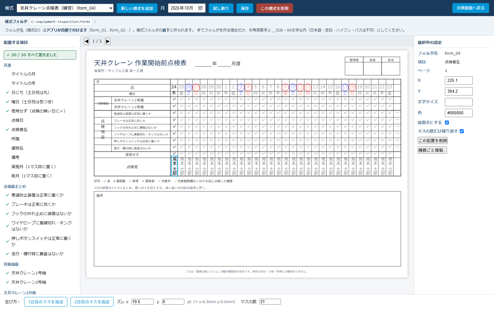

*全部置き終えると、左上が「✓ 20 / 20 すべて置きました」になります。右は「点検者名」を縦書きにしたところです。*

**右の「選択中の設定」の項目**

| 項目 | 内容 |
|---|---|
| X・Y | 印字する位置（pt） |
| 文字サイズ | 文字の大きさ（pt）。空欄なら 11 |
| 色 | 文字の色。`#000000`（黒）のように、# と6桁の英数字で書きます |
| 丸の半径 | 「日にち」の土日祝の丸の大きさ（pt）。空欄なら文字サイズに合わせます |
| 縦書きにする | 1文字ずつ下へ並べる（「日にち」「曜日」には出ません） |
| マスの数だけ繰り返す | 10-5 の繰り返しの対象にするか |
| この配置を削除 | この配置を消す |
| 機器ごと複製… | 次の 10-7 を参照 |

### 10-7. 機器ごとに同じ並びを複製する

機器ごとに判定欄が上下（または左右）に並んでいる用紙では、1台目の項目をすべて置いたあと、「機器ごと複製」で2台目以降へ写せます。

1. 1台目の機器の点検項目を、すべて置きます。
2. 置いた印のどれかを選び、右の「機器ごと複製…」を押します。
3. 「複製元」と「複製先」の機器を選び、ずらす量（pt）を入れて「複製」を押します。X は右が正、Y は **上が正** なので、下の段へ写すときは Y に負の数を入れます。

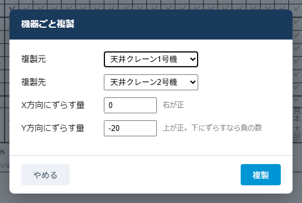

- 複製されるのは、複製元の機器の「点検項目」と「点検項目（備考）」の配置です。複製先に無い点検項目は飛ばします。
- 複製先にすでに同じ項目が置いてあるときは、新しい位置で上書きします。

### 10-8. 試し刷りと保存

1. 上の段の「試し刷り」を押します。配置を保存してから、見本のデータで印字したPDFが別のタブで開きます。
2. 印字された文字がマスからはみ出していないか、ずれていないかを確かめます。紙に印刷して、元の用紙と重ねて光に透かすと、ずれがよく分かります。

   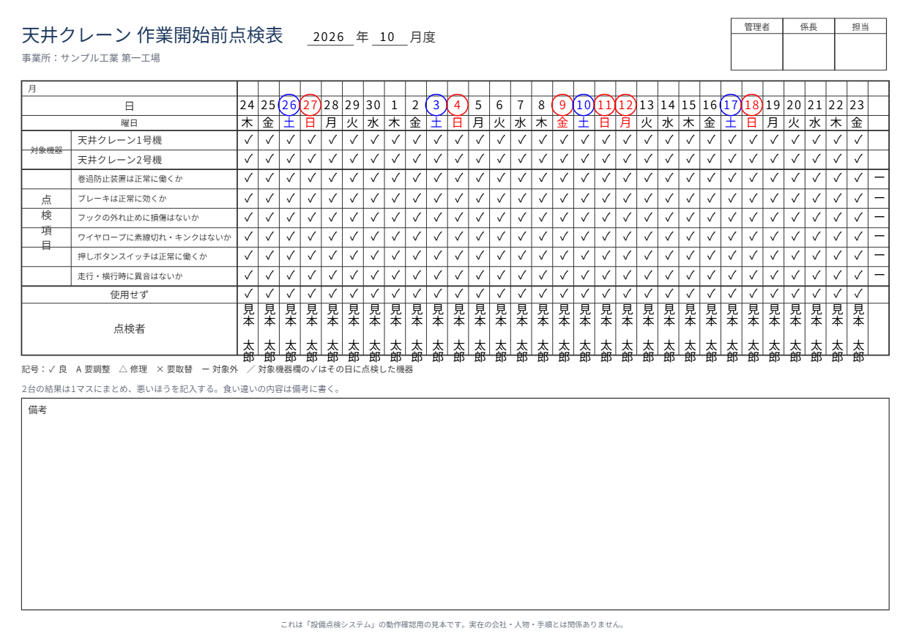

   *試し刷りでは、すべてのマスが見本のデータ（✓・「見本 太郎」）で埋まります。建物名は常に「見本ビル」と出ます。この例では文字が少し大きいので、文字サイズを小さくするとマスに収まります。*

3. ずれていたら、画面に戻って位置や文字サイズを直し、もう一度「試し刷り」を押します。
4. 位置が合ったら「保存」を押します。置いていない点検項目が残っているときは「まだ置いていない点検項目が ○ 件あります」と確認が出ます。そのまま保存すると、その項目は印字されません。

保存した様式は、次に「📄 PDF出力」を押したときから、点検結果PDFの2枚目以降に入ります（[6章](#6-月末のpdf出力) 参照）。どの機器がどの様式に載るかは、点検画面の「⚙ 設定」→「様式の割り当て」で確かめられます。

### 10-9. 用紙が複数ページあるとき

中央の上の「◀」「▶」で、ページを切り替えます。項目は、表示しているページに置かれます。右の「ページ」で、その配置が何ページ目かを確かめられます。

### 10-10. 様式の削除と、元に戻すとき

- 「この様式を削除」を押しても、すぐには消えません。様式フォルダの中の `.trash` フォルダに移るだけです。
- 元に戻すときは、`.trash` からフォルダを様式フォルダへ出し、名前の最後に付いた日時（`_20261025_153000` のような部分）を消してください。
- 配置を保存するたびに、その様式のフォルダの `backups` に、直前の10回分の設定が残ります。

### 10-11. 応用：印の文字を変える

用紙によっては、「良」を ✓ ではなく ○ で書く決まりのことがあります。印の文字は、様式ごとの設定ファイル `layout.json` を書き換えると変えられます（この設定は画面からはできません）。

1. 様式フォルダの `form_01` などのフォルダにある `layout.json` を、メモ帳で開きます。
2. 印の文字を変えたい項目の `{ … }` の中に、次のような行を足します。

   ```json
   "source": "item:*|ブレーキは正常に効くか",
   "mark_ok": "○",
   ```

3. 文字コードを「UTF-8」のまま保存します。次の「試し刷り」や「PDF出力」から反映されます。

| 書く名前 | 置き換える印 |
|---|---|
| `mark_ok` | ✓（良） |
| `mark_adjust` | A（要調整） |
| `mark_repair` | △（修理） |
| `mark_ng` | ×（要取替） |
| `mark_na` | ー（対象外・余った日のマス） |
| `mark_target` | 対象機器欄の ✓ |
| `mark_unused` | 使用せず欄の ✓ |

> **注意**
> - 書き換えるあいだは、様式レイアウト画面を閉じておいてください。書き換える前から開いていた画面で「保存」を押すと、書き換えた内容が元に戻ります。
> - `layout.json` は、カンマ（,）や引用符（"）が1つ欠けるだけで読めなくなります。書き換える前に、ファイルを別の場所にコピーしておいてください。読めなくなった様式は、PDF出力では表の形に切り替わり、レイアウト画面の一覧にエラーが出ます。

---

## 11. 他のPCやタブレットから使う

最初の設定では、アプリを動かしているPCからしか開けません。同じ社内LANのほかのPCやタブレットからも使うときは、次のようにします。

### 11-1. 設定を変える

1. アプリのフォルダに `config.json` が無いときは、先に点検画面の「⚙ 設定」を開き、何も変えずに「保存」を押します。これで `config.json` が作られます（GitHub から取ったばかりのときは、まだありません）。
2. アプリを終わらせます（黒い窓で `Ctrl` + `C`）。
3. アプリのフォルダの `config.json` をメモ帳で開きます。
4. `"host": "127.0.0.1"` の部分を `"host": "0.0.0.0"` に書き換えて保存します。

   ```json
   "server": {
     "host": "0.0.0.0",
     "port": 5000
   }
   ```

5. `起動.bat` で起動し直します。初めてのときは Windows のファイアウォールの確認が出るので、「アクセスを許可する」を押します。

> **注意**
> `"port": 5000` の数字は変えないでください。このアプリは 5000 番で使う前提で作られています。

### 11-2. ほかのPCから開く

1. アプリを動かしているPCで、スタートメニューから「コマンドプロンプト」を開き、`ipconfig` と入力して Enter を押します。
2. 「IPv4 アドレス」の数字（例：`192.168.1.20`）を控えます。
3. ほかのPCやタブレットのブラウザで、`http://（控えた数字）:5000` を開きます。

### 11-3. 管理者キー

ほかのPCから設定を **保存** するときは、管理者キーが要ります。

- 管理者キーは、`config.json` を書き換えて起動したとき、黒い窓に表示されます。アプリのフォルダの `admin_key.txt` にも保存されています。
- ほかのPCで設定画面を開くと「管理者キー」の欄が出るので、そこに入れてから保存します。
- 点検の入力と保存には、管理者キーは要りません。

> **大切**
> このアプリは、社内LANの中だけで使う前提で作られています。点検の入力には、パスワードがありません。インターネットから見える場所には置かないでください。

---

## 12. バックアップと引っ越し

### 12-1. バックアップするもの

次のフォルダとファイルを、定期的に別の場所（共有フォルダやUSBメモリなど）へコピーしてください。

| もの | 中身 |
|---|---|
| `results` | 点検記録（いちばん大切です） |
| `data` | 機器・点検項目・点検者・会社の休日 |
| `forms` | 点検用紙と印字位置の設定 |
| `signage_pdfs` | サイネージで映すファイル |
| `config.json` | 建物名・管理者・各画面の設定 |

文書閲覧のフォルダを別の場所に置いている場合は、そちらもバックアップしてください。

> **ヒント**
> アプリは、点検記録と設定を保存するたびに、直前の10回分を `backups` フォルダに自動で残しています。うっかり上書きしたときは、ここから戻せます。

### 12-2. 新しいPCへ引っ越す

1. 新しいPCに、[3章](#3-入れ方と起動) のとおりアプリを入れ、`初回セットアップ.bat` まで済ませます。
2. 古いPCの上の表のフォルダとファイルを、新しいPCのアプリのフォルダへ上書きコピーします。
3. `起動.bat` で起動し、点検画面で過去の月度の記録が見えることを確かめます。

> **注意**
> `.venv` フォルダはコピーしないでください。PCごとに `初回セットアップ.bat` で作り直すものです。

### 12-3. 新しい版に入れ替える

GitHub に新しい版が出たときは、**新しいフォルダに入れてから、記録と設定を移す** 方法で入れ替えます。古いフォルダはしばらく残しておけるので、うまくいかなかったときにすぐ戻せます。

1. いまの版を、点検画面の左下（例：「Ver 0.10.1」）で確かめておきます。
2. アプリを終わらせます（黒い窓で `Ctrl` + `C`）。
3. 新しい版の ZIP を [3-2](#3-2-アプリを取ってくる) と同じ手順で取り、**別の名前のフォルダ**（例：`C:\equipment-inspection-new`）に展開します。
4. 古いフォルダから新しいフォルダへ、次のものをコピーします（新しいフォルダに同じ名前のものがあるときは、上書きします）。

   | コピーするもの | 中身 |
   |---|---|
   | `data` | 機器・点検項目・点検者・会社の休日 |
   | `results` | 点検記録 |
   | `forms` | 点検用紙と印字位置の設定 |
   | `signage_pdfs` | サイネージで映すファイル |
   | `config.json` | 各画面の設定 |
   | `admin_key.txt` | 管理者キー（ほかのPCから設定するときに使うもの） |
   | `backups` | 自動バックアップ（念のため） |

5. 新しいフォルダで `初回セットアップ.bat` を実行します（新しい版で部品が増えていることがあるため）。
6. 新しいフォルダの `起動.bat` で起動し、点検画面の左下の版が新しくなったこと、過去の月度の記録が見えることを確かめます。
7. 問題が無ければ、古いフォルダの名前を変えて（例：`equipment-inspection-old`）しばらく残し、新しいフォルダの名前を元の名前（例：`equipment-inspection`）に変えます。フォルダの場所が元どおりになるので、自動起動のショートカットもそのまま使えます。

> **注意**
> 新しい版の `data` フォルダには、サンプルの工場の表が入っています。4 で古いフォルダの `data` を上書きコピーするのを忘れると、点検画面がサンプルの内容になります。

### 12-4. 使うのをやめるとき

アプリは、Windows の設定には何も書き込みません。使うのをやめるときは、必要な記録（`results` など）を別の場所にコピーしてから、アプリのフォルダごと消せば終わりです。自動起動を設定していた場合は、スタートアップフォルダのショートカットも消してください。Python が不要になったら、Windows の「設定」→「アプリ」から削除できます。

---

## 13. 困ったとき

| 困ったこと | 原因と対処 |
|---|---|
| `.bat` を開くと「Windows によって PC が保護されました」と出る | インターネットから取ったファイルに付く警告です。「詳細情報」→「実行」で進めます。次からは、ZIP を展開する前に「許可する」にしてください（[3-2](#3-2-アプリを取ってくる) 参照） |
| `初回セットアップ.bat` で「ライブラリのインストールに失敗しました」と出る | インターネットにつながっていないか、会社のネットワークが接続を制限しています（[3-3](#3-3-初回セットアップ初めてのときだけ) 参照） |
| 点検の入力欄が押せない（灰色になっている） | その機器のその日（月例は、その月度）の点検は、もう保存されています。保存した点検は画面からは直せません（[5-1](#5-1-使用前点検) 参照） |
| 表（CSV）に足した機器や点検者が出てこない | ブラウザで `F5` を押して、画面を読み込み直してください |
| `初回セットアップ.bat` で「Python が見つかりません」と出る | Python が入っていないか、「Add python.exe to PATH」にチェックが入っていません。[3-1](#3-1-python-を入れる初めてのときだけ) のとおり入れ直してください |
| `起動.bat` で「実行環境が見つかりません」と出る | 先に `初回セットアップ.bat` を実行してください |
| 黒い窓に「ポート 5000 は使用中のため…」と出る | ほかのアプリが 5000 番を使っています。黒い窓に出たアドレスで開けますが、ほかのPCからのアドレスも変わってしまうため、5000 番を使っているアプリを止めて起動し直してください |
| 画面が開かない・「接続できません」と出る | 黒い窓（アプリ本体）が閉じています。`起動.bat` で起動し直してください |
| ほかのPCからつながらない | `config.json` の host が `0.0.0.0` になっているか、ファイアウォールで許可したかを確かめてください |
| CSVを直したら文字化けした | Excel で「CSV UTF-8（コンマ区切り）」を選んで保存し直してください |
| 「PDF出力」でメッセージが出てPDFが出ない | 点検が済んでいない機器があります。[6章](#6-月末のpdf出力) を見てください |
| 点検用紙の印字がマスからずれる | 様式レイアウト画面で位置（X・Y）や文字サイズを直し、「試し刷り」で確かめてください。少しずつ横にずれていくときは、「並び方」のズレ x・y を直します（[10-5](#10-5-1か月分1年分のマスを繰り返す) 参照） |
| 点検用紙のはずが、表の形で出てくる | その様式の設定が読めなくなっています。様式レイアウト画面の様式の一覧に出るエラーを確かめてください。`layout.json` を手で直した場合は、控えておいたファイルに戻してください |
| 点検用紙に何も印字されない | 「⚙ 設定」→「様式の割り当て」で、その機器が用紙に割り当てられているか確かめてください。表示している月度に記録があるかも確かめてください |
| サイネージに何も映らない | `signage_pdfs`（またはサイネージ設定の「PDFフォルダ」）にファイルがあるか、拡張子が上の表のものか確かめてください。スリープの時間帯は時計だけになります |
| 動画が映らずに次のファイルへ進む | そのPCのブラウザが、その動画の形式を再生できない可能性があります。動画をブラウザの画面に直接ドラッグして、再生できるか確かめてください |
| 保存できない | 保存先フォルダに書き込めるか確かめてください。くわしい原因は `logs\app.log` に記録されています |

---

## 付録：サンプルを作り直すには

`samples` フォルダの中身は、すべて `samples\make_samples.py` が描いたものです。中身を直したいときは、このファイルを書き換えてから、アプリのフォルダでコマンドプロンプトを開き、次のように実行します。

```
.venv\Scripts\python.exe samples\make_samples.py
```

- `samples` の中の点検用紙・サイネージ・文書・点検記録が作り直されます。
- 点検記録は、サンプルの工場の機器名で作られます。`data` フォルダを自分の職場の内容に書き換えている場合、サンプルの記録は点検画面に出ません。
- 本物の `config.json` や `results` には触りません。

---

## 付録：用語集

| ことば | 意味 |
|---|---|
| 使用前点検 | 機器を使う日に、使う前に行う点検。このアプリでは、その日の分だけ記録できます |
| 月例点検 | 月に1回行う点検。点検した日を選んで記録します |
| 月度 | 点検をまとめる1か月の区切り。最初の設定では「前の月の24日〜その月の23日」で、たとえば「10月度」は9月24日〜10月23日です |
| 締め日 | 月度が始まる日（最初の設定では24日） |
| 使用せず | 使用前点検の記録が無い日。次の日になると自動で印が付きます |
| 特記事項 | 点検のときに「備考」に書いた内容。PDFの1枚目に一覧で載ります |
| 様式 | 会社で使っている紙の点検表のPDFと、そのどこに何を印字するかの設定の組 |
| 試し刷り | 様式に見本のデータを印字したPDF。位置を確かめるために使います |
| サイネージ | お知らせのPDF・画像・動画を、画面に順番に映す機能 |
| 管理者キー | ほかのPCから設定を保存するときに入れる合いことば。`admin_key.txt` に入っています |
| 黒い窓 | `起動.bat` を開くと出る窓。アプリの本体で、閉じるとアプリが止まります |
